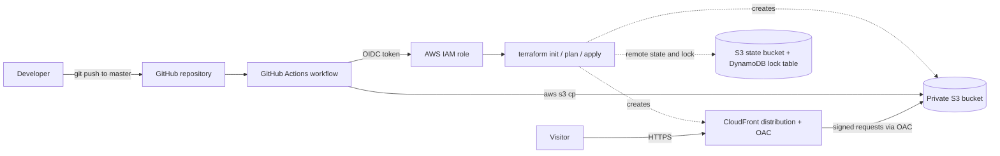
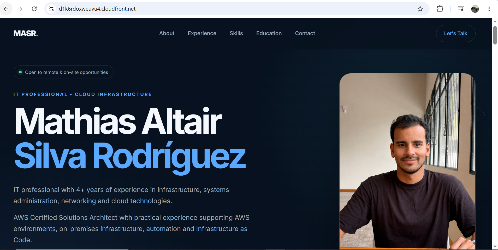
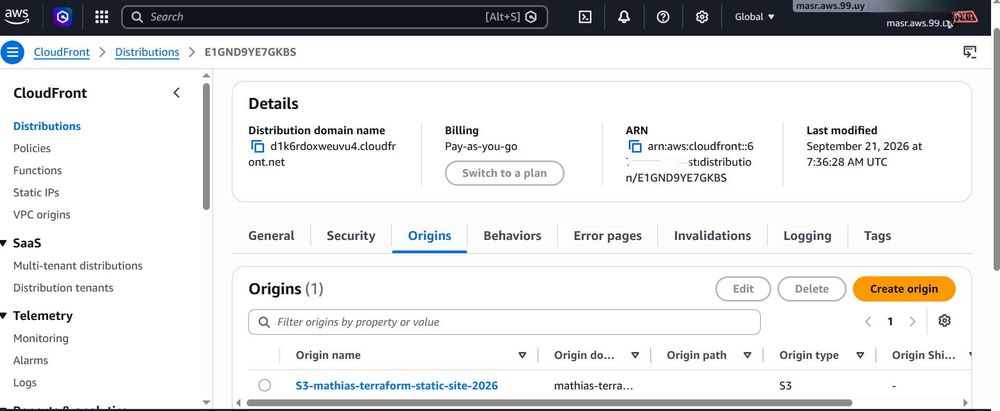
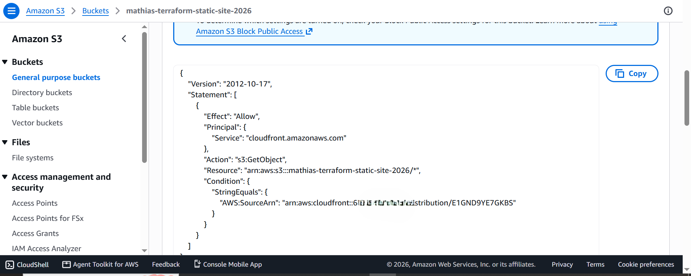
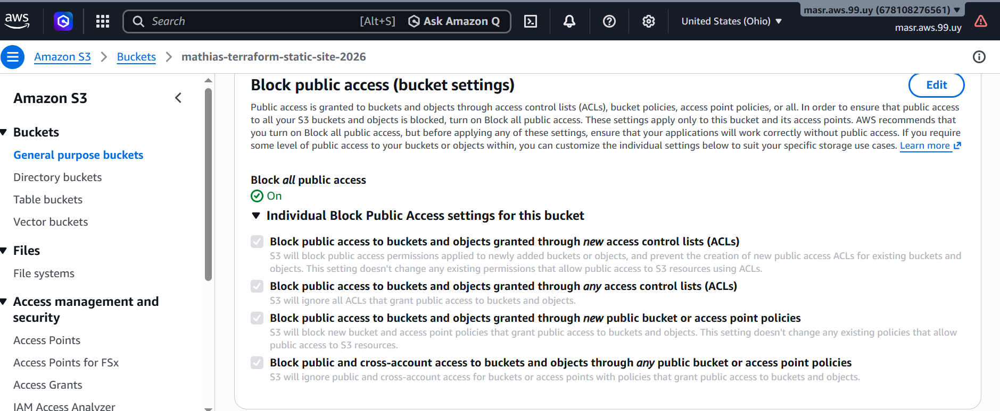
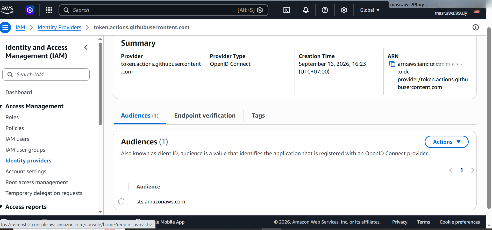
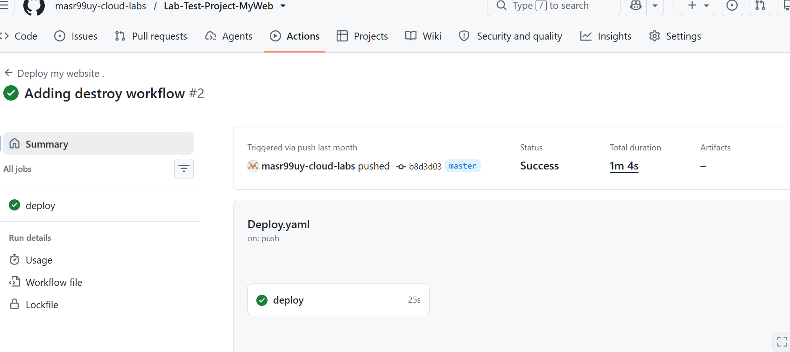

# Static Website on AWS: Private S3 + CloudFront (OAC), Terraform and GitHub Actions (OIDC)

A personal static website (HTML/CSS) served through **CloudFront** from a **private S3 bucket**. The whole infrastructure is defined with **Terraform**, and every push to "master" runs a **GitHub Actions** workflow that provisions the infrastructure and deploys the site, authenticating to AWS with **OIDC** (no long-lived access keys stored anywhere).

> **Note:** I already had AWS experience and the Solutions Architect Associate certification, and I used this project especially to practice Infrastructure as Code and CI/CD end to end. I built it by following a Udemy course ([Cloud Automation Projects: AWS, Terraform & GitHub Actions](https://www.udemy.com/course/aws-terraform-github-actions-projects-personal-website/)) and then improved it on my own using other sources and AI assistants (ChatGPT, Claude) to clarify concepts, debug issues and draft documentation.

> **About the site:** the HTML/CSS was generated with AI from my CV. The focus of this project is the infrastructure and the deployment pipeline, not the front-end.
>

> **Live demo:** the site ran on a temporary AWS free-tier account that has since expired, so the CloudFront URL is no longer available. The screenshots below show it running. Since the whole infrastructure is defined in Terraform, I plan to redeploy it on a new account and I will update this note when it is live again.

## Architecture

## Tech stack

- **AWS:** S3, CloudFront (Origin Access Control), IAM (OIDC identity provider and role), DynamoDB (Terraform state lock).
- **Terraform:** infrastructure as code, remote state in S3 with locking
- **GitHub Actions:** CI/CD, triggered on every push to "master" or manually (`workflow_dispatch`)
- **HTML/CSS:** the site itself.

## What Terraform creates

- An S3 bucket for the site files (`force_destroy = true` so the lab can be torn down cleanly)
- S3 Block Public Access with all four settings enabled
- A CloudFront Origin Access Control (OAC) and a CloudFront distribution using the bucket as its origin, with `index.html` as the default root object and the default CloudFront certificate
- An S3 bucket policy that only allows `s3:GetObject` to the CloudFront service, and only from this specific distribution (`AWS:SourceArn` condition).

The Terraform **state is stored remotely** in an encrypted S3 bucket (`backend "s3"` with `encrypt = true`) and **locked with a DynamoDB table**, so two runs cannot modify the infrastructure at the same time. The state bucket and the lock table were created manually before the first run (the usual bootstrap step).

## Deployment pipeline

The workflow in `.github/workflows/Deploy.yaml` runs on every push to `master` and can also be started manually:

1. Checks out the repository.
2. Assumes an AWS IAM role through **OIDC** (GitHub proves its identity to AWS; no access keys are stored in GitHub).
3. Installs Terraform and runs `terraform init`, `terraform plan` and `terraform apply -auto-approve`.
4. Uploads `index.html`, `Images/` and `styles/` to the S3 bucket with the AWS CLI.

The role ARN, region and bucket name are stored as GitHub Actions secrets (`IAM_ROLE`, `AWS_REGION`, `BUCKET_NAME`), not hardcoded in the repository.

### Teardown workflow

A second workflow, `.github/workflows/Destroy.yaml`, removes everything. It can only be started **manually** (`workflow_dispatch`, never on push), runs `terraform plan -destroy` first and then `terraform destroy`. That keeps the lab cheap and avoids leaving resources running by accident.

## Screenshots

**The website served through CloudFront**

**CloudFront origin configuration**

**S3 bucket policy (access only from the CloudFront distribution)**

**S3 Block Public Access settings**

**IAM OIDC identity provider**

**GitHub Actions deployment run**

## Security notes

- **No long-lived credentials:** GitHub Actions uses OIDC and short-lived tokens.
- **The bucket is private.** Block Public Access is fully enabled, and only CloudFront can read the objects through OAC, restricted to this one distribution.
- **Encrypted, locked state:** the Terraform state bucket uses encryption and a DynamoDB lock.
- **No identifiers in the code:** role ARN, region and bucket name come from GitHub secrets.

## Design decisions

- **From a public bucket to a private bucket with OAC.** I first served the site from the S3 static website endpoint, which requires a public bucket. I later switched to a private bucket with Origin Access Control, which is the recommended approach, and removed the old configuration from the code.
- **OIDC instead of access keys:** short-lived credentials, nothing sensitive to leak or rotate.
- **Everything in Terraform:** the infrastructure can be created and destroyed reproducibly, which is why `force_destroy` is enabled for this lab.
- **No custom domain:** a domain and certificate were outside the AWS free plan, so the site is served from the default CloudFront domain. With a budget I would add a domain in Route 53 and a certificate in ACM.

## Known limitations and next improvements

I know these are not production-ready yet, and they are my next steps:

- Invalidate the CloudFront cache at the end of each deployment (changes can take a long time to show because of the default TTL).
- Replace the role's `AdministratorAccess` with a least-privilege policy (S3 on the site bucket and the state key, DynamoDB on the lock table, and the CloudFront actions Terraform needs), and use a separate read-only role for `plan` on pull requests.
- Run `terraform plan` on pull requests and `apply` only after merge (today `apply -auto-approve` runs on every push to `master`).
- Move the state lock from DynamoDB to the S3 backend's native locking (`use_lockfile`), since `dynamodb_table` is being deprecated in recent Terraform versions.
- Add a custom domain with HTTPS.

## Deploy it yourself

Requirements: an AWS account, Terraform, and a GitHub repository.

1. Create the Terraform backend: an S3 bucket and a DynamoDB table for the lock, and update the `backend "s3"` block in `terraform/provider.tf` with your names.
2. In the AWS console, create an OIDC identity provider for GitHub and an IAM role that GitHub Actions can assume (I created mine manually). For this lab the role has broad permissions (`AdministratorAccess`) to keep the exercise simple, and its trust policy restricts which GitHub account and repository can assume it.
3. Add the repository secrets `IAM_ROLE`, `AWS_REGION` and `BUCKET_NAME`.
4. Push to `master`, or run the workflow manually from the Actions tab.
5. Open the CloudFront URL that Terraform outputs.

## Cost and cleanup

Designed to run within the AWS free plan. To remove everything, run the **Destroy** workflow manually from the Actions tab. The S3 bucket is created with `force_destroy = true`, so Terraform can delete it even when it contains files. The backend bucket and the lock table are not managed by this Terraform code, so they are removed by hand if no longer needed.

## What I learned

- **Terraform:** resource dependencies, variables, and remote state in an S3 backend with state locking.
- **Private S3 with CloudFront OAC:** serving a site from a private bucket, with a bucket policy that only lets my distribution read it.
- **GitHub Actions:** a workflow that runs Terraform and uploads the site, a separate manual Destroy workflow, and secrets instead of hardcoded values. I also learned to follow the run logs to find out why a run failed.
- **OIDC:** authenticating GitHub Actions to AWS with a role instead of long-lived access keys.